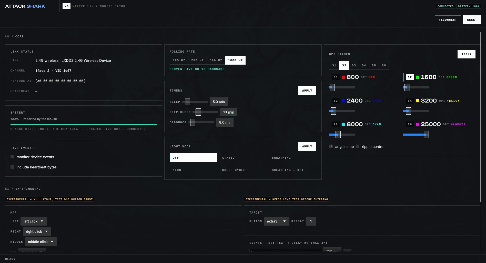

# attackshark-rs

Native Linux tool for ATTACK SHARK V6-family gaming mice. A from-scratch Rust
port of the Windows-only `ATTACK SHARK V6 SOFT` app — no Wine, no vendor
driver, no root after a one-time setup. Talks HID directly to the 2.4G
receiver over USB (and reads battery over Bluetooth).

> **V6 only** — this tool works exclusively with the ATTACK SHARK V6
> (2.4G receiver `1d57:fa60/fa65`, wired `1d57:2224`). It does not support
> other ATTACK SHARK models.



## What it does

- **DPI stages** — 6 stages (default 800 / 1600 / 2400 / 3200 / 8000 / 25000),
  each with its own LED color, active-stage select, angle snap + ripple toggles
- **Polling rate** — 125 / 250 / 500 / 1000 Hz
- **Lighting** — off / static / breathing / neon / color cycle, color + speed
- **Power** — sleep timer, debounce, live battery meter from the heartbeat
- **Buttons + macros** (experimental) — remap 8 buttons, send macro packets
- **Factory reset** — one click restores vendor defaults
- **Responsive single-page UI** — core cards up top, experimental section
  below; narrow windows stack the cards instead of squeezing them

Every write is verified against the mouse's ACK on the interrupt pipe, and the
footer reports exactly what the hardware said back.

## Supported hardware

| VID:PID | Device |
|---------|--------|
| `1d57:fa60` / `fa65` | 2.4G receiver ("LXDDZ 2.4G Wireless Device") |
| `1d57:2224` | Wired V6 |

Confirmed live on V6 hardware (USB + Bluetooth battery). The protocol family
is shared across standard models (the vendor's 18 `hiddriver` DLLs are
byte-identical) — see `PROTOCOL.md`.

## Install

One-time setup (asks for root **once**, ever — installs a udev rule so the
receiver is readable by your user):

```sh
cargo build --release
./install.sh
# unplug the receiver, plug it back in
```

After that, never sudo again.

## Usage

```sh
attackshark-ui            # the GUI (also: cargo run --bin ui)
attackshark-rs list       # find the mouse
attackshark-rs info       # open config channel + read feature A0
attackshark-rs watch      # stream input reports live
attackshark-rs set-feature <id> <hex bytes...>
```

## Protocol

Reverse-engineered from the vendor binary with USB captures — every claim is
backed by observed bytes, not guesses. Full documentation in [`PROTOCOL.md`](PROTOCOL.md):

- Config channel: SET_REPORT feature on interface 2, ACK form `03 24 50 00 <id>`
- DPI blob (`04`, 56B) · prefs (`05`) · lighting (`06`) · polling (`06`) ·
  commit-first `0C` prefix every batch needs
- Battery rides the 2.4G heartbeat `03 24 41 01 <pct>`

`tools/` holds the raw capture logs and the Wine-era shims (historical
interest only — nothing in the build needs them).

## Layout

```
src/
  lib.rs        open_usb(), bt_battery_pct(), send_commit()
  protocol.rs   packet builders, LightMode, buttons, macros, checksums
  bt.rs         Bluetooth battery via BlueZ/D-Bus
  main.rs       CLI: list / info / watch / set-feature
  bin/ui.rs     egui GUI — craft-launcher-styled bento, one page
examples/       per-feature probes (usb_set_stage, usb_sweep_light, ...)
install.sh      one-time udev rule + binary install
99-attackshark.rules
```

## Status

Working: DPI, polling, lighting, power, battery, reset. Experimental
(needs live verification): button remap, macros. Tested on Arch Linux
(Omarchy) against V6 hardware, 2026-10-12.
